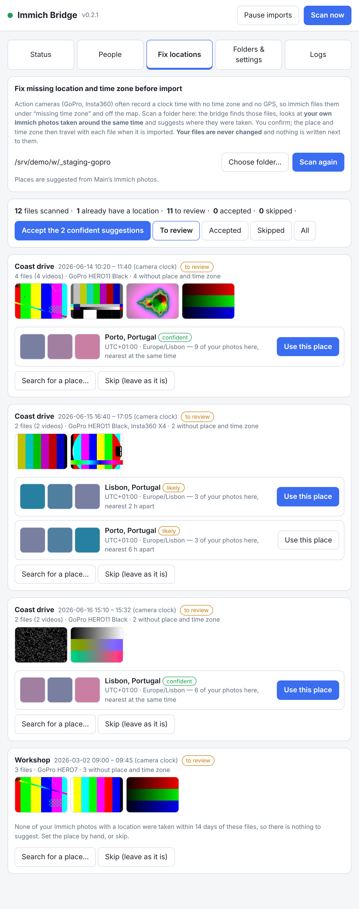

# copyparty → Immich bridge

A small standalone Docker service that auto-imports media uploaded to a
[copyparty](https://github.com/9001/copyparty) server into
[Immich](https://immich.app). Anything any device uploads to the watched
copyparty volume — phone, laptop, camera workflow — shows up in Immich
automatically, deduplicated by content checksum.

Designed to run next to the existing copyparty and Immich containers on the
same host (e.g. a Proxmox VM), sharing copyparty's data volume read-only.

## How it works

```
uploader ──► copyparty ──(xau event hook: JSON POST)──► bridge ──(Immich API)──► Immich
                 │                                        ▲
                 └── shared volume (read-only) ───────────┘  + periodic sweep
```

1. **Instant path** — copyparty's `xau` (execute-after-upload) event hook runs
   a tiny forked script that POSTs the upload's JSON (`ap`, `sz`, `mt`, …) to
   the bridge's `/hook` endpoint. Forked = uploads are never blocked, hook
   failures never hurt copyparty.
2. **Reliable path** — the bridge also sweeps the watched directory tree on
   startup and every `SWEEP_INTERVAL_SECONDS`, so files uploaded while the
   bridge was down (or before it existed) are still imported. `.hist`,
   dotfiles and in-progress `*.PARTIAL` uploads are excluded; files must be
   older than `MIN_FILE_AGE_SECONDS` so nothing is grabbed mid-write.
3. **Import** — for each candidate file the bridge:
   - checks the extension against Immich's own `GET /api/server/media-types`
     (so "compatible" always matches your Immich version; override with
     `INCLUDE_EXTENSIONS`),
   - streams a SHA-1 and asks `POST /api/assets/bulk-upload-check` — content
     already in Immich (e.g. already backed up by the phone app) is recorded
     as a duplicate and skipped,
   - otherwise uploads via `POST /api/assets` (with the `x-immich-checksum`
     header so a concurrent upload of the same bytes is also handled),
   - adds the asset to an album named after its folder (`ALBUM_FROM_FOLDER`, on by default; created on demand) and, optionally, one fixed album (`IMMICH_ALBUM_NAME`),
   - applies the post-import action (`keep` / `move` / `delete`, default `keep`),
   - records the outcome in a SQLite state DB (`/data/state.db`) so nothing is
     re-hashed or re-imported unless the file's size/mtime changes.
   Failures are retried on later sweeps, up to `MAX_ATTEMPTS` per file version.

## Setup

**Easiest: run the one-line installer in [INSTALL.md](INSTALL.md)** (finds your copyparty, builds and
starts the bridge, asks only for the Immich API key). The manual steps below are for reference.

1. Create an API key in Immich: **Account Settings → API Keys**.
2. Mount copyparty's data directory into the bridge **at the same container
   path** copyparty sees, read-only (see `docker-compose.example.yml`). If the
   paths must differ, set `PATH_MAP=/copyparty/prefix=/bridge/prefix`.
3. Mount `hook/immich_bridge_hook.py` into the copyparty container and add the
   event hook to copyparty's flags, globally:

   ```
   --xau f,j,t30,/hooks/immich_bridge_hook.py
   ```

   or per-volume (volflag): `-v /w/uploads:uploads:rw,ed:c,xau=f,j,t30,/hooks/immich_bridge_hook.py`

   Set `IMMICH_BRIDGE_URL=http://immich-bridge:8099` on the copyparty
   container. The hook is optional — without it imports simply wait for the
   next sweep.
4. `docker compose up -d --build` and watch `docker logs immich-bridge`.

## Configuration (environment variables)

| Variable | Default | Purpose |
|----------|---------|---------|
| `IMMICH_URL` | *(required)* | Immich server base URL, e.g. `http://immich-server:2283` |
| `IMMICH_API_KEY` / `IMMICH_API_KEY_FILE` | *(required)* | Immich API key (or a file containing it, for secrets) |
| `WATCH_DIRS` | *(required)* | Comma-separated directory paths (as mounted in the bridge) to watch |
| `PRIORITY_DIRS` | *(empty)* | Comma-separated folders **inside `WATCH_DIRS`** imported first (e.g. the folder the phone app uploads into). Everything else under `WATCH_DIRS` is still imported, just after. Empty = no preference |
| `PATH_MAP` | *(empty)* | `src=dst[,src=dst]` prefix rewrites from copyparty's paths to the bridge's |
| `SWEEP_INTERVAL_SECONDS` | `900` | Reconciliation sweep period; `0` = sweep once at startup only |
| `MIN_FILE_AGE_SECONDS` | `30` | Sweep ignores files modified more recently than this |
| `MAX_ATTEMPTS` | `5` | Retry budget per file version before giving up |
| `POST_IMPORT_ACTION` | `keep` | `keep`, `move` (to `MOVE_SUBDIR`), or `delete` — move/delete need a `rw` mount |
| `MOVE_SUBDIR` | `.imported` | Subfolder (next to the file) used by `move` |
| `ALBUM_FROM_FOLDER` | `true` | Add every imported file to an Immich album named after the folder it sits in (e.g. `Day 3 hike/IMG_1.jpg` → album `Day 3 hike`), created on demand. Only the immediate folder is used; hidden folders are ignored. `false` turns it off |
| `IMMICH_ALBUM_NAME` | *(empty)* | If set, imported assets are ALSO added to this one fixed album (created on demand) |
| `INCLUDE_EXTENSIONS` | *(empty)* | Comma-separated extension allow-list; empty = ask Immich |
| `STATE_DB` | `/data/state.db` | SQLite state DB path |
| `BIND_HOST` / `BIND_PORT` | `0.0.0.0` / `8099` | Hook/status HTTP listener |
| `DEVICE_ID` | `copyparty-immich-bridge` | `deviceId` reported to Immich |
| `IMMICH_VERIFY_TLS` | `true` | Set `false` for self-signed Immich certs |
| `WORKERS` | `1` | Parallel import workers (1 is right for most setups) |
| `LOG_LEVEL` | `INFO` | `DEBUG` for per-request detail |
| `BRIDGE_TOKEN` | *(empty)* | Secret for the web page / `/api/*` and for `/hook`. **Empty = the settings API is switched off** and `/hook` stays open (old behaviour). The installer generates one |
| `BROWSE_ROOTS` | *(empty)* | Folders the web page's folder picker may list, and watched folders must sit inside (the installer sets it to copyparty's data mount). Empty = no folder picker |
| `SETTINGS_FILE` | `/data/settings.json` | Where settings saved from the web page are kept (on the state volume) |
| `USERS_FILE` | `/data/users.json` | The other people (Immich key, folders, copyparty logins), written by the People tab. Holds API keys: mode 600. Unreadable = the bridge refuses to start |
| `PEOPLE_ROOT` | *(empty)* | Folder-per-person mode: a folder whose subfolders are named `<firstname>-<immich user id>`. The main account then imports only its own folder; a folder nobody is set up for is imported by nobody (also editable on the page: People tab) |
| `IMMICH_ML_URL` | *(empty)* | Immich's machine-learning service (e.g. `http://immich_machine_learning:3003`), used by Fix locations to join look-alike groups. The installer finds it and attaches the bridge to its Docker network (`IMMICH_ML=<container>` picks one, `IMMICH_ML=off` disables). Empty = groups by time only |
| `IMMICH_CLIP_MODEL` | `ViT-B-32__openai` | The image-recognition model asked for; set it to the one in Immich's Administration > Machine Learning, or the service loads a second model |
| `GEOFIX_LOOK_ALIKE` | `0.80` | How alike (CLIP cosine similarity, 0-1) two groups' frames must be to be joined |
| `GEOFIX_SHOT_INTERVAL_S` | `90` | Seconds a shot assumed when dating an undated file from its file number and only one dated neighbour |
| `AUTO_FIX` | `false` | After import, set place and local time from the account's own geotagged photos, on strong evidence only (also editable through `PUT /api/config` as `auto_fix`). Main account only |
| `AUTO_FIX_WINDOW_S` | `1800` | How far in time a geotagged photo may be from a file to count as evidence |
| `LINK_KEEP_DAYS` | `7` | Days a file saved from a shared link stays on the NAS when automatic correction has not finished with it; once it is in Immich and corrected it is deleted at once. |
| `XMP_WAIT_S` | `45` | Seconds a RAW photo (or a photo in a folder with XMP files) waits for its camera sidecar to arrive before it is imported; 0 = never wait. The sidecar goes to Immich with the photo. |
| `AUTO_FIX_PAUSE_S` | `6` | Seconds to wait after each automatic change (at most 50 every 5 minutes), so Immich never gets a burst. |
| `BACKOFF_LOAD` / `BACKOFF_LOAD_OK` | `3.0` / `1.5` | Load per CPU at which the bridge backs off, and under which it resumes |
| `BACKOFF_PING_S` | `5` | An Immich ping slower than this counts as overloaded |
| `MQTT_URL` | *(empty)* | `mqtt://[user:pass@]host:1883`: publish state and events under `ImmichBridge/` (also `mqtt_url` on `PUT /api/config`). Empty = off |
| `PUBLIC_URL` | *(empty)* | The address others reach this page at; used in `/llms.txt` and to register in a device index over MQTT |
| `SOURCE_MAPS` | *(empty)* | Several copyparty containers: `name\|/their/path=/bridge/path[,…]` — how to translate hook paths from the container whose hook sets `IMMICH_BRIDGE_SOURCE=name` (the installer writes this for `EXTRA_COPYPARTY`) |

## Web page (settings, folder picker, status, logs)

Open `http://<vm>:8099/` (the installer prints a link with the token in it). Everything below
is behind `BRIDGE_TOKEN`:

- **Status** — counts, queue, recent files with errors.
- **Folders & settings** — add/remove several watched folders with a folder picker, star the
  ones imported first, scan interval, file-age guard, retry budget, post-import action, folder-named albums, one fixed album,
  allowed file types, log detail. Changes apply **immediately, no restart**, are validated
  first (nothing is applied if any field is wrong) and are saved on the state volume.
  Saved values win over the compose/env values until you press **Reset to installer defaults**.
- **Logs** — live tail with level + text filter and a **Download log** button (last 2000 lines
  since the container started; `docker logs immich-bridge` for older history).
- **Scan now** — runs the sweep immediately.
- **Pause imports / Resume imports** (header button) — stops anything new being imported while you check
  what it has done. The file being imported at that moment finishes; new uploads are still noticed and queued
  (the Status tab shows how many are waiting) and import as soon as you resume. The pause is saved, so a
  restart does not silently resume. Copyparty uploads and the rest of Immich are unaffected.

What the page deliberately cannot change (needs a compose change or restart): the Immich
URL and API key, the port, the worker count, and which host folders are mounted. A container
cannot see the host filesystem beyond what is mounted into it, so the folder picker lists
only what is mounted (the installer mounts copyparty's whole data root). To add a folder from
somewhere else, add a volume mount and re-run the installer. To change the port re-run the
installer with `BRIDGE_PORT=9000`. `move`/`delete` after import also need the data mounted
read-write (installer option `WRITABLE=1`); the page refuses them while it is read-only.

**Add photos from a shared link** (Status tab): paste a Google Photos shared album or Google Drive folder link, pick
one of the suggested album names (or type one) and press Import. The originals are saved to a new folder inside the
person's upload folder, imported into an album of that name, corrected like any upload, and the NAS copy is deleted
once Immich has the same bytes and correction has finished (or after `LINK_KEEP_DAYS`, default 7). Needs
`WRITABLE=1`.

## Fix locations (missing GPS / time zone)

GoPro and Insta360 files often carry a clock time with no time zone and no GPS. The **Fix locations** tab
(`/?t=locations`) scans a folder for such files, suggests a place and time zone for each group from your own Immich
photos taken around the same time, and lets you confirm. Accepted choices are sent with each file as an XMP sidecar
when the bridge imports it. Files are never modified and nothing is written next to them. See `CHANGELOG.md` (0.3.0)
for the limits. Example of what is sent next to `GX010011.MP4` (made-up data):

```xml
<exif:DateTimeOriginal>2026-06-14T10:20:05+01:00</exif:DateTimeOriginal>
<exif:GPSLatitude>41,9.096000N</exif:GPSLatitude>
<exif:GPSLongitude>8,36.654000W</exif:GPSLongitude>
```

How files are grouped and dated (0.5.0):

- **Groups follow real recording time.** A new group starts after a 3-hour gap from where the previous *recording*
  ended. GoPro chapters (`GH01nnnn`, `GH02nnnn`, …) are one recording; its end comes from the chapters' close times,
  so a time-lapse that plays for 5 minutes but took 80 minutes ends 80 minutes later.
- **Look-alike groups are one card.** Groups of one folder within 12 hours of each other whose frames look like the
  same place are joined, using Immich's own image recognition (its machine-learning container, `IMMICH_ML_URL`; only
  small preview frames are sent to it). **Split into separate cards** keeps them apart (remembered) as linked cards
  with **Use for both**; **Join again** undoes it. Without the service, groups are split by time only.
- **An unset camera clock is no date.** Jan 1 00:00:00 of any year, a Jan 1–2 date followed by a shot from the same
  camera 300+ days later, a date before the camera model existed, or a future date. Such files (and files with no
  date) are dated from the camera's own file number (`DSC_0042`): between two dated shots of the same camera and
  folder, else about 90 s a shot (`GEOFIX_SHOT_INTERVAL_S`) from the nearest, at most 40 shots away. The estimate goes
  to Immich with a description saying how it was made (`Date estimated by copyparty-immich-bridge: …`).
- **A geotagged shot next to an untagged one** (same camera and folder, at most 10 file numbers away) is the first
  suggestion for its place.

**Automatic correction (`AUTO_FIX`).** When the queue is empty, files the bridge imported without a place are checked
against the account's geotagged photos. A change needs a known true instant and agreeing photos within 30 minutes (two
within 5 km of each other, or one within 10 minutes). Everything else is left alone and listed with its reason at
`GET /api/geofix/auto`; `POST /api/geofix/auto/run` starts a pass now. Each change is logged with the values it replaced.



## Endpoints

- `POST /hook` — copyparty event receiver (single JSON object, or a list for
  `xiu` batch hooks). Needs the token when `BRIDGE_TOKEN` is set
- `GET /status` — open: totals only (counters by status, queue depth, `paused`, backlog, `users`, `backoff`); the per-person keys (`watch_dirs`, `priority_dirs`, `albums`, `recent`, `active`) are present but empty. With the bridge token (`X-Bridge-Token`) it adds watch/priority dirs, album health (`albums`: key permission check, added/failed counts, last error, back-fill progress), the 20 most recent items and `extras` (auto-correct counts, MQTT); `?user=<id>` (token) is one person's view
- `GET /status/me` — the phone app's own view: header `X-Immich-Token: <the app's Immich access token>`. The bridge asks Immich (`/api/users/me`) whose token it is and answers that person's `?user=` view plus `me` and `immich_user`. 401 = no or wrong token, 404 = an Immich user with no bridge account, 503 = Immich could not be asked (try later). Answers are remembered 5 min (60 s for a wrong token), keyed by a hash; the token is never logged. Send it over https only
- `POST /api/links/inspect` `{"url"}` — reads a shared album: title, photo/video counts, days, `suggestions` (first = default); `POST /api/links/import` `{"url", "name"?}` — starts the download + import (202 with the job); `GET /api/links` — recent jobs with `kept_on_nas`. Bridge token (`user` = person), or `X-Immich-Token` (always the signed-in person)
- `GET /healthz` — liveness (open)
- `GET /` — the web page (the page itself is public; all data behind it needs the token)
- `GET|PUT /api/config`, `POST /api/config/reset`, `GET /api/fs?path=`, `GET /api/logs`,
  `GET /api/logs/download`, `POST /api/scan`,
  `GET|POST /api/users`, `PUT|DELETE /api/users/<id>`, `POST /api/users/check`, `GET|POST /api/users/<id>/adopt`, `GET /api/people-folders` (dropdown data), `POST /api/users {people_folder, api_key}` (folder-per-person add), `POST /api/users/ignored/remove` (the People tab; see INSTALL.md "More than one person"; `?user=<id>` or `{"user": id}` scopes the other endpoints, default `main`), `POST /api/pause` (`{"paused": true|false}`), `POST /api/reimport` (`{"confirm": true}`: forget what was imported and import it all again), `POST /api/account/ack` (accept the current Immich account), `POST /api/albums/backfill` (add everything already imported to its folder album), `POST /api/albums/recheck` (re-test the key's album permissions) — the web page's backend. Send the token as
  `X-Bridge-Token: <token>` or `Authorization: Bearer <token>`

## Notes & limits

- **Safety**: files are only moved/deleted *after* Immich has confirmed the
  content (fresh upload or checksum duplicate). Default is to touch nothing.
- Sidecar files (`.xmp`) are not imported standalone (Immich doesn't accept
  them without their asset); they're recorded as skipped.
- The state DB is authoritative for "already imported" — deleting an asset in
  Immich will not cause a re-import unless you also clear the DB row (or the
  file's mtime changes). This is deliberate: it makes deleting from Immich safe.
- The bridge never writes to copyparty's `.hist` or interferes with up2k;
  it only ever reads completed files (and moves/deletes them if you opt in).

## Development

```
python3 -m pytest tests/          # unit + stub-server integration tests
```
